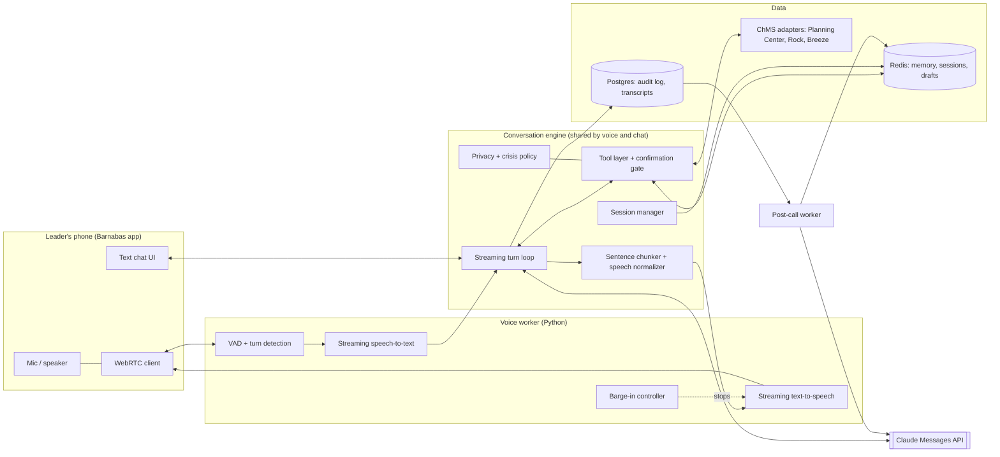

# Barnabas voice and chat harness: design

Status: draft v1, November 2026
Scope: the system that sits between a ministry leader's voice (or keyboard) and Claude. It covers turn-taking, the tool loop, memory, privacy rules and the post-call work. Mobile UI and the ChMS sync are covered only where they touch the harness.

## 1. What the harness has to do

Barnabas is a voice-first assistant for ministry leaders. It remembers each leader's context across conversations and can look up and act on church data. The harness must:

1. Hold a natural two-way voice conversation. That means fast replies, the leader can interrupt, and there is never dead air while a tool runs.
2. Give Claude the leader's memory before the first word, without a lookup round trip.
3. Let Claude read church data and draft actions, but never send or change anything without the leader's spoken confirmation.
4. Enforce the church's privacy rules in code, especially about the congregants a leader cares for.
5. Learn from every conversation afterward, without making the leader wait.
6. Run the same engine for text chat, so voice and chat behave identically.

## 2. Architecture



Key decisions:

| Decision | Choice | Why |
|---|---|---|
| Claude surface | Messages API with our own streaming tool loop | We need every stream event (text deltas for speech, tool starts for holding phrases) and full control of interruption. Managed Agents runs the loop on Anthropic's side, with a sandbox container we don't need. |
| Voice pattern | Cascade: speech-to-text, then Claude, then text-to-speech | The Messages API takes text, images and PDFs and returns text; it has no audio input or output ([Features overview](https://platform.claude.com/docs/en/build-with-claude/overview)). A cascade also leaves a clean transcript for memory and audit. |
| Voice framework | LiveKit Agents or Pipecat (open source) | They handle WebRTC transport, voice-activity detection, turn detection and interruption, and both have Claude plugins. Pick one in a one-week spike. |
| Language | Python for the voice worker and engine | Both frameworks are Python-first, and the Anthropic Python SDK has the memory-tool helpers. |
| Model | Claude Opus 5.5 at `low` effort for voice turns | Conversation does well at low effort. Raise effort per message for hard turns. Fast mode and smaller models are levers to test, not defaults. |
| Memory | Markdown files per leader in Redis | Claude's memory tool is client-side: the `/memories` path maps onto storage we control, such as "keys in a database" ([memory tool docs](https://platform.claude.com/docs/en/agents-and-tools/tool-use/memory-tool)). |

## 3. A voice turn, step by step

1. **The leader opens Barnabas.** The session manager authenticates them. It loads the church's policy and the leader's `core.md` memory from Redis, builds the system prompt, and sends a `max_tokens: 0` pre-warm request so the first real reply reads from cache.
2. **The leader speaks.** Voice-activity detection and a turn-detection model decide when they've finished. Tune the end-of-speech silence threshold longer for care conversations, where people pause.
3. **Speech-to-text returns the final transcript.** Boost the vocabulary with names from the church directory, ministry names and the books of the Bible, so "Mrs. Nguyen" and "Habakkuk" come through correctly.
4. **The engine appends a user message and streams a Claude request.** History is append-only (section 5).
5. **Text deltas go to the sentence chunker.** Each finished sentence goes through a speech normalizer and then to text-to-speech. The normalizer turns "John 3:16" into "John three sixteen", "11:30" into "eleven thirty" and "$1,200" into "twelve hundred dollars". Audio starts while Claude is still writing.
6. **A tool call starts** (a `tool_use` content block begins in the stream). The voice worker immediately plays a short prerecorded holding phrase for that tool ("Let me check Sunday's roster"). Read-only tools can start as soon as their block finishes streaming. Write tools wait for the full response and the confirmation gate.
7. **Tool results go back** in one user message, and the loop continues until `stop_reason` is `end_turn`.
8. **The leader interrupts.** The barge-in controller stops playback and flushes the speech queue. Section 5 covers what goes into history.
9. **The call ends.** The transcript is saved and the post-call worker updates memory (section 7).

Latency budget. Set a target per stage and measure it in production:

| Stage | What to measure |
|---|---|
| End-of-speech detection | Silence until the turn is closed |
| Speech-to-text | Turn closed until final transcript |
| Claude | Request sent until the first text token |
| First sentence | First token until the first sentence is complete |
| Text-to-speech | Sentence sent until the first audio byte plays |
| **Total** | **Leader stops talking until Barnabas starts talking**, the number that decides whether it feels natural |

The total is the product metric. Track p50 and p90, and keep tool-call turns separate from plain turns.

## 4. The Claude request

One request shape serves voice and chat. Fields below are the raw API names. The Python SDK takes the same names, with `betas=[...]` for the header.

```json
{
  "model": "claude-opus-5-5",
  "max_tokens": 16000,
  "stream": true,
  "thinking": { "type": "adaptive" },
  "output_config": { "effort": "low" },
  "fallbacks": "default",
  "cache_control": { "type": "ephemeral" },
  "tools": [ "...custom tools, each with \"eager_input_streaming\": true..." ],
  "system": [
    { "type": "text", "text": "<Barnabas persona, voice style, privacy and crisis rules: same for every leader>",
      "cache_control": { "type": "ephemeral" } },
    { "type": "text", "text": "<church policy + this leader's core.md + today's briefing>",
      "cache_control": { "type": "ephemeral" } }
  ],
  "messages": [ "...append-only history..." ]
}
```

Header: `anthropic-beta: server-side-fallback-2026-07-01`.

- **Caching.** Tools render first, then system, then messages. The first breakpoint caches the tools plus the shared persona, so it is reused across every leader. The second caches this leader's context for the call. Top-level `cache_control` caches the growing conversation. That uses 3 of the 4 allowed breakpoints. Check `usage.cache_read_input_tokens` in production: if it stays at zero, something in the prefix is changing between requests.
- **Never put changing values in `system`.** The current time, location or "the leader is driving" go in as a mid-conversation system message (`{"role": "system", ...}` appended after a user message). That keeps the cached prefix intact.
- **Thinking.** Opus 5.5 always thinks; `effort` is the control. The default display is `omitted`, which suits voice because thinking is never spoken. For a hard turn ("help me plan a sermon series on Ruth"), raise effort for that turn with per-message effort (beta `mid-conversation-output-config-2026-07-01`) instead of changing the top-level setting, which would break the cache.
- **Refusals.** Always check `stop_reason` before reading content. With `fallbacks: "default"`, a safety-classifier refusal is retried on a fallback model inside the same call, so the leader doesn't get dead air. If a refusal still comes back, Barnabas speaks a short, kind fallback line.
- **Tool inputs.** With `eager_input_streaming`, tool inputs stream as they're written, but the API no longer validates them. Parse with a JSON parser, validate against the schema before running, and return a tool error on anything invalid.
- **Message threads** (`thread` field) cut request size in long loops. Leave them off at first: voice calls are short, and threads are not eligible for zero data retention, which may matter for pastoral data.

## 5. Conversation state and interruptions

- **We own the transcript.** Every message is stored in Redis during the call and in Postgres after it. The API is stateless, and our copy is the source of truth.
- **Append-only, always.** Never edit or delete an earlier turn. On Claude Opus 5.5, thinking blocks are tied to the exact conversation: edited history causes earlier reasoning to be dropped or the request to be rejected, and it also breaks the cache.
- **Barge-in without rewriting history.** When the leader interrupts:
  1. Stop the audio immediately, but let the Claude stream finish in the background. Interrupted replies are short, so the extra tokens cost little.
  2. Append the complete assistant message exactly as returned.
  3. Append the leader's new words as the next user message.
  4. Append a mid-conversation system message: *"The leader interrupted you after: '…last sentence actually played…'. They did not hear the rest."*

  Track which chunks were actually played so that note is accurate.
- **Long text chats.** If a chat gets very long, use server-side compaction instead of trimming history in code. Voice calls rarely need it; each call starts fresh with memory preloaded.

## 6. Tools and the confirmation gate

Use small, dedicated tools rather than one general tool, so the harness can gate, log and render each action.

| Tool | Kind | Notes |
|---|---|---|
| `find_person(name)` | Read | Returns candidates with IDs; Barnabas asks when the name is ambiguous ("Sarah Kim or Sarah Lopez?") |
| `get_person_summary(person_id)` | Read | Serving, attendance, groups, open follow-ups. Filtered by the leader's ChMS permissions and the privacy policy |
| `get_volunteer_load(team?)` | Read | Burnout radar signals: load across ministries, consecutive weeks, declines, drop in the volunteer's own group or worship attendance |
| `get_schedule(from, to)` | Read | Services, rosters, events |
| `recall_memory(topic)` | Read | Reads a topic file from the leader's memory, such as `people/sarah-kim.md` |
| `save_memory(note, kind, about_person_id?)` | Write, low risk | Saves a note during the call; policy-checked and logged |
| `draft_message(recipients, channel, text)` | Write, reversible | Creates a draft in the review queue. Translates per recipient's stored language |
| `log_care_event(person_id, type, follow_up?)` | Write | Minimal record: who, what kind of contact, next step |
| `send_draft(draft_id)` | Write, **gated** | See below |
| `block_time(start, end, label)` | Write, **gated** | Calendar holds for rest and sabbath |

**Confirmation gate.** Gated tools run only if the leader's most recent turn explicitly confirmed that specific action. The engine checks this in code; the model's judgment alone isn't enough. If the check fails, the tool returns an error saying "Ask the leader to confirm before sending," and Barnabas asks: "Want me to send it?" In the app, gated actions also show an on-screen confirm button.

**ChMS access.** Start with Planning Center's public API: it has the largest customer base, and its 2026 connectors show it is opening up to AI tools. Then add Rock and Breeze/Tithely adapters. Wrap each ChMS in our own tools instead of attaching its MCP server directly. That lets us filter fields (no medical notes or security codes), cache lookups for speed, and enforce the leader's permissions in one place. ChurchTrac's API is closed, so its churches need a CSV import.

**Run parallel reads concurrently.** If Claude asks for two lookups in one response, run both at once and return both results in a single message.

## 7. Memory

### Layout in Redis

```
mem:{church_id}:{leader_id}:/memories/core.md            role, ministries, preferences, standing commitments
mem:{church_id}:{leader_id}:/memories/people/{slug}.md   minimal follow-ups per congregant
mem:{church_id}:{leader_id}:/memories/topics/{slug}.md   sermon series, projects, plans
mem:{church_id}:{leader_id}:index                        set of paths (for the directory view)
mem:{church_id}:{leader_id}:provenance                   memory line -> source conversation id
conv:{church_id}:{leader_id}:{conversation_id}           live transcript during a call
audit:{church_id}                                        Redis stream of every memory write and tool call
```

- The `church_id:leader_id` namespace comes from the authenticated session, **never from the path Claude sends**.
- Reject any path that doesn't start with `/memories`, or that contains `..`, backslashes or URL-encoded traversal.
- Cap the size of each file and of each leader's total memory, and expire topic files nobody has read in a long time.
- Redis becomes the system of record for what Barnabas knows, so turn on AOF persistence, backups and encryption at rest, or mirror every write to Postgres.

### During a call: preload, don't look up

When the official memory tool is in a request, the API adds an instruction telling Claude to view its memory directory before anything else. On a voice turn, that lookup would come before the first spoken word. So the live path does not attach the memory tool:

- `core.md` and the directory listing are preloaded into the second system block.
- `recall_memory` and `save_memory` (section 6) give fast, narrow access during the call.

### After a call: consolidate with the memory tool

A post-call worker runs one request with Claude's memory tool (`{"type": "memory_20250818", "name": "memory"}`) over the finished transcript. The instruction is: update this leader's memory under the church's memory policy, keep `core.md` short, and merge rather than duplicate. Our handler implements the six commands (`view`, `create`, `str_replace`, `insert`, `delete`, `rename`) against Redis. The Python SDK's `BetaAbstractMemoryTool` lets us supply only the storage. Every write goes through the policy check, is tagged with its source conversation, and is logged.

The same worker updates the burnout and care-load signals and prepares the next morning's briefing, so the first call of the day starts instantly.

## 8. Privacy and safety rules (enforced in code)

1. **Isolation.** Each leader's memory is visible only to that leader. Church admins can't read it; they can only turn the feature off.
2. **Visible memory.** The app has a "What Barnabas remembers" screen with per-item edit and delete. Barnabas also answers "What do you know about me?" and honors "Forget that."
3. **Deletes cascade.** Deleting a conversation deletes every memory line whose provenance points to it. Several mainstream assistants don't do this; we should.
4. **Off the record.** An off-the-record mode writes no transcript and no memory. Barnabas offers it at the start of counseling-adjacent conversations.
5. **Rules about congregants.**
   - **Default:** store a person reference plus a minimal follow-up ("check on him after surgery, by Nov 20").
   - **Never stored by default:** diagnoses, counseling content, family conflict, finances or anything about minors beyond a follow-up. The church's policy can widen these rules, and the leader must opt in.
   - The policy check runs on every memory write and every `log_care_event`.
6. **No secrets.** Passwords, account numbers, door codes and similar are rejected before storage.
7. **Crisis protocol.** If a leader reports that someone may harm themselves or others, Barnabas doesn't counsel. It gives the 988 Suicide & Crisis Lifeline (US), urges contacting the person and emergency services now, and follows the church's escalation policy. This rule lives in the shared system prompt and is tested in the eval set.
8. **Identity.** Barnabas is an AI assistant, not a pastor. It doesn't claim spiritual authority, and it points leaders to people, prayer and their own judgment.

## 9. The Barnabas system prompt (outline)

- **Who Barnabas is:** an encouraging assistant for ministry leaders, named for the "son of encouragement" (Acts 4:36). Warm, brief and practical. Never pretends to be human or a pastor.
- **Writing for the ear:**
  - Short sentences, one question at a time.
  - No lists, markdown or headings in voice mode.
  - Say names naturally and round numbers.
  - Confirm before any send or schedule change.
- **Memory:** the leader's core memory is already loaded below, so don't look it up again. Save only what the policy allows, and say so when you save something important ("I'll remember that").
- **Tools:** draft first and send only after the leader confirms. If a name is ambiguous, ask.
- **Privacy, crisis and identity rules** from section 8.
- **The church's policy block** (per church) and the **leader's context block** (per leader) follow as the second system block.

## 10. Evals before launch

Build a set of about 50 scripted conversations, using a simulated leader whose turns respond to Barnabas's replies:

- Sunday prep
- A hospital visit briefing
- A volunteer burnout alert
- A Spanish reminder to volunteers
- An ambiguous name
- "Forget that"
- A crisis disclosure
- An attempt to send without confirming

Measure:

- **Latency:** leader-stops-talking to Barnabas-starts-talking, p50 and p90
- **Tool accuracy:** right tool, right person
- **Memory precision:** saved what it should, refused what the policy forbids
- **Gate integrity:** zero sends without confirmation
- **Crisis handling:** 100% follow the protocol

Re-run the set before every change to the model, effort, prompt or tools.

## 11. Build plan

| Phase | Deliverable | Proves |
|---|---|---|
| 0. Text engine (2–3 weeks) | Chat-only Barnabas: streaming loop, tools against a Planning Center sandbox, Redis memory, post-call consolidation, privacy rules, eval set | Memory quality and privacy rules, with no voice complexity |
| 1. Push-to-talk voice (2 weeks) | LiveKit Agents or Pipecat worker, speech-to-text with vocabulary boosting, text-to-speech, sentence chunker and normalizer | The latency budget, with simple turn-taking |
| 2. Hands-free voice (2–3 weeks) | Turn detection, barge-in, holding phrases, off-the-record mode | A natural conversation |
| 3. Features on the engine | Burnout radar briefings, care-load tracking, multilingual drafts with a review queue, then the church-to-church network | The differentiated features from the market research |

Vendor choices for speech-to-text and text-to-speech (for example Deepgram, AssemblyAI, ElevenLabs, Cartesia, or Azure and Google speech) belong in the Phase 1 spike. Compare them on latency, accuracy with church vocabulary, Spanish and Korean support, the warmth of the Barnabas voice, and data-retention terms.
